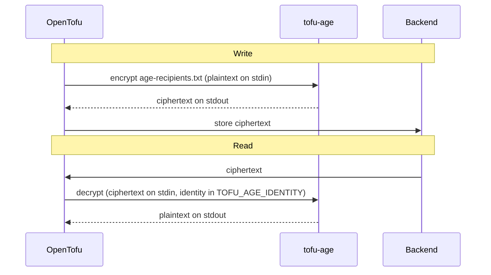

# Design: OpenTofu state encryption with age

Taken from the handoff of Oct 7, 2026.

## Context and goal

OpenTofu state and plan files will be encrypted with age, through OpenTofu's external encryption **method**. Without a valid age identity, the files in the backend are unreadable.

- **Why encrypt:** state holds secrets in plaintext (database passwords, tokens, generated keys). Today, anyone with read access to the backend can read them.
- **Why age instead of a PBKDF2 passphrase:** there is no shared secret. Each engineer and each CI runner has its own keypair. Access is granted or removed by editing a recipients file.
- **Why age instead of a KMS:** OpenTofu has no KMS key provider for our hosting. age gives the same per-file envelope encryption without running OpenBao.
- **Terminology:** this uses the external *method*, not the external *key provider*. A key provider only supplies a key to OpenTofu's built-in AES-GCM. The method replaces the encryption step itself. No key provider is configured at all.

## How it works

OpenTofu calls `tofu-age` every time it writes or reads a state or plan file. The backend only ever stores ciphertext.



On every write, age generates a new random file key and wraps it separately for each public key in the recipients file. On a read, any single matching identity can unwrap that key. This is the same envelope design as the KMS key providers, without running a KMS, and every write gets a fresh key.

## The tofu-age wrapper

`tofu-age` is a small static Go binary built on `filippo.io/age`. It translates between OpenTofu's external-method protocol and age. The `age` CLI can't be used directly because it doesn't speak that protocol.

The protocol is simple:

- **Header:** the program writes one JSON line first: `{"magic":"OpenTofu-External-Encryption-Method","version":1}`.
- **Input:** OpenTofu writes JSON to stdin: `{"payload":"<base64>","key":"<base64, optional>"}`.
- **Output:** the program replies on stdout with `{"payload":"<base64>"}`.
- **Diagnostics:** errors go to stderr, and a non-zero exit fails the operation. stdout is reserved for the protocol, so nothing else may print there.

The schemas live in [opentofu/internal/encryption/method/external/protocol](https://github.com/opentofu/opentofu/tree/main/internal/encryption/method/external/protocol).

`internal/protocol` implements it without any crypto, so the stdout contract is tested separately from age:

- **The header goes out first,** before the input is read. Whatever fails afterwards, stdout holds the header and at most one output object; on an error it holds the header alone, and the error goes to stderr.
- **The input is decoded as strictly as the schema describes it.** An unknown field, a missing or `null` payload, or anything after the object is an error.
- **A non-empty `key` is refused.** tofu-age takes no key provider, so a key means one was configured on the method by mistake. Silently ignoring it would hide that mistake.
- **An empty result is written as `""`,** never `null`, which the output schema rejects.
- **The tests validate against OpenTofu's schemas,** vendored under `internal/protocol/testdata` at the OpenTofu release that `ghcr.io/specsnl/opentofu` ships. `task schemas:update` downloads them again, and a monthly workflow runs `task schemas:check`, which fails once a newer OpenTofu release changes them.

Keys come from two places:

- **Encryption** reads public keys from a recipients file whose path is passed as an argument.
- **Decryption** reads the private identity from the `TOFU_AGE_IDENTITY` environment variable. It is never read from a file, so it can be injected by `op run` or a CI secret.

The proof of concept, in one file:

```go
// Command tofu-age is an OpenTofu external encryption method backed by age.
//
//	tofu-age encrypt <recipients-file>   # public keys, one per line; safe to commit
//	tofu-age decrypt                     # identity read from TOFU_AGE_IDENTITY
package main

import (
	"bytes"
	"encoding/json"
	"errors"
	"fmt"
	"io"
	"log"
	"os"
	"strings"

	"filippo.io/age"
)

type header struct {
	Magic   string `json:"magic"`
	Version int    `json:"version"`
}

// []byte fields are base64-encoded/decoded by encoding/json, matching the protocol.
type input struct {
	Key     []byte `json:"key,omitempty"`
	Payload []byte `json:"payload"`
}

type output struct {
	Payload []byte `json:"payload"`
}

func main() {
	log.SetFlags(0)
	log.SetOutput(os.Stderr)

	if len(os.Args) < 2 {
		log.Fatal("usage: tofu-age encrypt <recipients-file> | tofu-age decrypt")
	}

	// json.Encoder appends a newline, which terminates the single-line header.
	if err := json.NewEncoder(os.Stdout).Encode(header{"OpenTofu-External-Encryption-Method", 1}); err != nil {
		log.Fatal(err)
	}

	var in input
	if err := json.NewDecoder(os.Stdin).Decode(&in); err != nil {
		log.Fatalf("reading input: %v", err)
	}

	var (
		result []byte
		err    error
	)
	switch os.Args[1] {
	case "encrypt":
		if len(os.Args) != 3 {
			log.Fatal("usage: tofu-age encrypt <recipients-file>")
		}
		result, err = encrypt(in.Payload, os.Args[2])
	case "decrypt":
		result, err = decrypt(in.Payload)
	default:
		err = fmt.Errorf("unknown mode %q", os.Args[1])
	}
	if err != nil {
		log.Fatal(err)
	}

	if err := json.NewEncoder(os.Stdout).Encode(output{Payload: result}); err != nil {
		log.Fatal(err)
	}
}

func encrypt(plaintext []byte, recipientsFile string) ([]byte, error) {
	f, err := os.Open(recipientsFile)
	if err != nil {
		return nil, fmt.Errorf("opening recipients file: %w", err)
	}
	defer f.Close()

	recipients, err := age.ParseRecipients(f)
	if err != nil {
		return nil, fmt.Errorf("parsing recipients: %w", err)
	}

	var buf bytes.Buffer
	w, err := age.Encrypt(&buf, recipients...)
	if err != nil {
		return nil, fmt.Errorf("starting encryption: %w", err)
	}
	if _, err := w.Write(plaintext); err != nil {
		return nil, fmt.Errorf("encrypting: %w", err)
	}
	// Close flushes the final chunk and authentication tag; skipping it truncates the output.
	if err := w.Close(); err != nil {
		return nil, fmt.Errorf("finalizing encryption: %w", err)
	}
	return buf.Bytes(), nil
}

func decrypt(ciphertext []byte) ([]byte, error) {
	raw := os.Getenv("TOFU_AGE_IDENTITY")
	if raw == "" {
		return nil, errors.New("TOFU_AGE_IDENTITY is not set")
	}

	identities, err := age.ParseIdentities(strings.NewReader(raw))
	if err != nil {
		return nil, fmt.Errorf("parsing identity: %w", err)
	}

	r, err := age.Decrypt(bytes.NewReader(ciphertext), identities...)
	if err != nil {
		return nil, fmt.Errorf("decrypting: %w", err)
	}
	return io.ReadAll(r)
}
```

Before first use:

- [ ] Pin `filippo.io/age` in `go.mod`, so the exact code that wrote a state file can be rebuilt later.
- [ ] Add a round-trip test: encrypt with a test recipient, then decrypt with the matching identity.
- [x] Add protocol tests: the header line comes first, and only JSON is written to stdout.
- [ ] Add a failure test: a missing or wrong identity must exit non-zero.

## Key management

Every person or system that needs to read state gets its own age keypair. The public half goes into a recipients file committed to the repo. The private half never touches disk or the repo.

| Holder               | Private identity lives in                                    | Injected via                               | Public key goes in   |
|----------------------|--------------------------------------------------------------|--------------------------------------------|----------------------|
| Each engineer        | 1Password, one item per person                               | `op run` with `TOFU_AGE_IDENTITY=op://…`   | `age-recipients.txt` |
| CI (GitHub Actions)  | Repository or organization secret                            | `env: TOFU_AGE_IDENTITY: ${{ secrets.… }}` | `age-recipients.txt` |
| Break-glass recovery | 1Password vault with restricted access, plus an offline copy | Manual, emergencies only                   | `age-recipients.txt` |

The break-glass key is not optional. If every identity listed in the file is lost, the state can never be decrypted again. There is no reset path.

To generate a keypair:

```sh
age-keygen -o key.txt            # prints the public key (age1…)
op item create --category "Secure Note" --title "tofu-age <name>" "notesPlain=$(cat key.txt)"
rm key.txt
```

The recipients file takes one public key per line. Comments say who each key belongs to, which makes removing someone later unambiguous:

```text
# alice (laptop)
age1q…
# ci (github actions, specsnl)
age1x…
# break-glass
age1z…
```

For local use, keep a `.env.tofu` with `TOFU_AGE_IDENTITY=op://<vault>/<item>/notesPlain` and run `op run --env-file=.env.tofu -- tofu plan`. A Taskfile wrapper keeps this to one command.

## Configuration and base image

The configuration has no key provider, and `enforced = true` on both targets. With enforcement on, a run that somehow lacks encryption fails instead of silently writing plaintext.

```hcl
terraform {
  encryption {
    method "external" "age" {
      encrypt_command = ["tofu-age", "encrypt", "age-recipients.txt"]
      decrypt_command = ["tofu-age", "decrypt"]
    }

    state {
      method   = method.external.age
      enforced = true
    }

    plan {
      method   = method.external.age
      enforced = true
    }
  }
}
```

There is no migration from plaintext, so no `unencrypted` fallback is configured: existing state is recreated under the new method.

The recipients path is resolved relative to the directory `tofu` runs in, so keep the file next to the root module. The method name `age` is effectively permanent: state metadata is tied to it, and renaming it requires a `fallback` step.

If another configuration reads this state through `terraform_remote_state`, it also needs a `remote_state_data_sources` block that uses the same method. Without it, that read fails once the state is encrypted.

Distribution is Docker only. Releases ship Linux tarballs and a `checksums.txt`, and `ghcr.io/specsnl/opentofu` installs the binary from them the same way it installs Terramate, so the image gains no Go toolchain.

The image contains the binary only, never an identity. Decryption rights are decided at runtime by whichever secret gets injected. Tag the image whenever `tofu-age` changes, so every pipeline runs a known version.

## Operations

Recipient changes take effect only on the next state write. age encrypts to the list of recipients at write time, so an existing file still reflects the old list until it is rewritten.

- **Adding someone:** add their public key to `age-recipients.txt`, then run `tofu apply` on every state they need. Until that write happens, they can't read the existing state.
- **Removing someone, or a lost laptop:** delete the line, then apply every state. Old versions in the backend's history can still be decrypted with the removed key. That person also saw the plaintext, so rotate the secrets stored in state.
- **Reading state without OpenTofu (break-glass):** pull the encrypted payload out of the envelope and decrypt it with age. Confirm the field name against a real encrypted file before relying on it.

  ```sh
  jq -r '.encrypted_data' terraform.tfstate | base64 -d | age -d -i break-glass.txt > plain.tfstate
  ```

- **Rolling back to plaintext:** add an `unencrypted` method, make it the primary method with `external.age` as the fallback, remove `enforced`, and apply.

## Risks and open decisions

The biggest risk is losing the ability to decrypt. Everything else is a limit on what encryption protects.

| Risk                                           | Why it matters                                       | Mitigation                                                                              |
|------------------------------------------------|------------------------------------------------------|-----------------------------------------------------------------------------------------|
| All identities lost                            | State can't be recovered, and there is no reset      | Break-glass key, tested against a real encrypted state file                             |
| `tofu-age` missing where `tofu` runs           | Reads fail, so no plan or apply is possible          | Ship it in the base image, and run `tofu` through it                                    |
| Hardware-backed keys (YubiKey, Secure Enclave) | `age.ParseIdentities` doesn't load plugin identities | Native X25519 keys only for now; supporting plugins means shelling out to the `age` CLI |
| Plaintext visible to whoever runs `tofu`       | Encryption only protects data at rest                | Run production applies from CI; restrict who holds production identities                |
| Old state versions                             | Removed keys still open historical versions          | Rotate secrets after removing a recipient                                               |

Decided:

- The source lives in a repo of its own, [specsnl/tofu-age](https://github.com/specsnl/tofu-age).
- Distribution is Docker only, through `ghcr.io/specsnl/opentofu`.
- There is no migration: existing state is recreated under the new method.

Open:

- [ ] Confirm the external method's stability status in the docs for the OpenTofu version we pin.
- [ ] Decide on one recipients file for everything, or one per environment (for example, production readable only by production CI, break-glass and named people).
- [ ] Name who holds the break-glass key.
- [ ] Confirm native X25519 keys only for v0.

## References

- [OpenTofu: State and Plan Encryption](https://opentofu.org/docs/language/state/encryption/)
- [OpenTofu: External encryption method](https://opentofu.org/docs/language/state/encryption/#external-encryption-method)
- [OpenTofu: Key and method rollover](https://opentofu.org/docs/language/state/encryption/#key-and-method-rollover)
- [External method protocol JSON schemas](https://github.com/opentofu/opentofu/tree/main/internal/encryption/method/external/protocol)
- [age](https://github.com/FiloSottile/age)
- [filippo.io/age Go package](https://pkg.go.dev/filippo.io/age)
